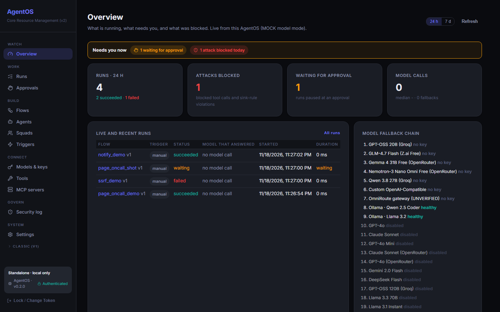
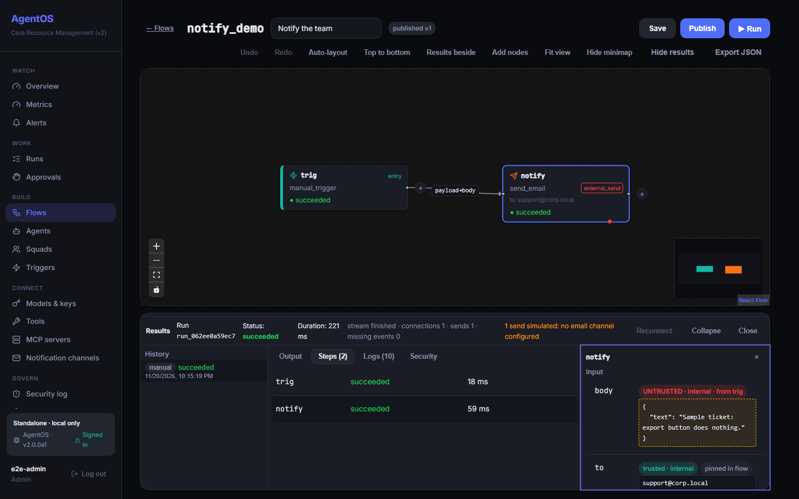
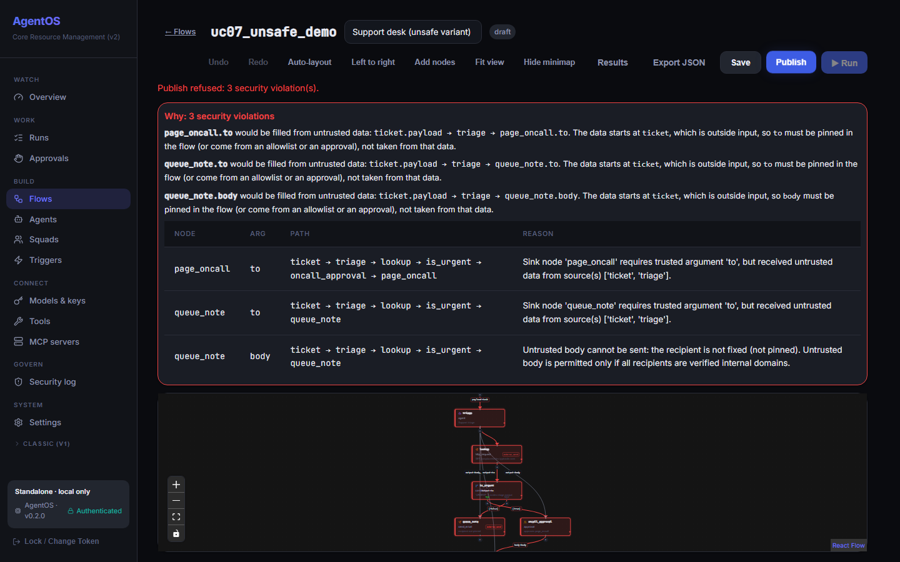

# AgentOS Framework

[](https://github.com/MujumdarSahil/Agent-OS-/actions)

AgentOS is a workflow engine for AI agents that is built to stay safe when the content it reads is hostile. You draw a flow in the browser (a webhook, schedule or manual trigger, agents, HTTP calls, conditions, approvals, and actions such as email) and AgentOS runs it. Every value carries a security label at the workflow level: data from webhooks, web pages, emails and tools is untrusted, so it can never choose who receives an email, which URL is called or whether a destructive action runs. Unsafe flows are refused when you publish them and blocked again at run time. When a person should decide, the flow stops at an approval that shows the exact call it would release. Model calls go through LiteLLM with a fallback order across free providers and an encrypted key vault, so one provider's outage or rate limit does not stop a flow. The status of each feature (verified, experimental or planned) is listed below, and the v1 Python API is documented in [docs/v1/README_v1.md](docs/v1/README_v1.md).

## Getting started

This walks you from a clean machine to the visual flow builder running in **MOCK mode**: no API keys,
no cost, a simulated LLM, and emails that are never actually sent. In MOCK mode every model call (agent, llm and
extraction nodes) is answered by a built-in scripted model: no model provider is contacted even if provider keys are
set in your environment or in a `.env` file (checked by `tests/ci/test_mock_no_egress.py`).

> Verified from a fresh clone on Windows 11 / PowerShell 5.1 (see `docs/evidence/raw/2.3-cp3-readme-quickstart.txt`).
> The macOS/Linux commands are the direct equivalents but were not run on macOS/Linux in that check.

### 1. Prerequisites

| Tool | Version | Needed for |
|---|---|---|
| Python | 3.11 | backend (`requires-python >= 3.11`) |
| Node.js | 20.19+ or 22.12+ (required by Vite 8) | web UI |
| Git | any recent | cloning |
| Docker Desktop | any recent | **only** Platform mode (MongoDB/Redis) |

### 2. Get the code and install

Windows PowerShell:
```powershell
git clone https://github.com/MujumdarSahil/Agent-OS-.git agentos
cd agentos
git checkout 2.0
python -m venv venv
.\venv\Scripts\python.exe -m pip install --upgrade pip
.\venv\Scripts\python.exe -m pip install -e .
cd ui
npm install
cd ..
```

macOS / Linux:
```bash
git clone https://github.com/MujumdarSahil/Agent-OS-.git agentos
cd agentos
git checkout 2.0
python3.11 -m venv venv
./venv/bin/python -m pip install --upgrade pip
./venv/bin/python -m pip install -e .
cd ui && npm install && cd ..
```

### 3. Quick start in MOCK mode (no API keys, no cost)

Use two terminals, both starting in the `agentos` folder.

**Terminal 1: backend.** These variables turn on the mock LLM, let runs started from the UI
actually execute (in-process worker), and trust `corp.local` as an internal email domain for the
examples (no domain is trusted by default).

Windows PowerShell:
```powershell
$env:AGENTOS_MOCK_LLM = "1"
$env:AGENTOS_INPROCESS_WORKER = "1"
$env:AGENTOS_INTERNAL_DOMAINS = "corp.local"
$env:AGENTOS_PROJECT = "demo"
.\venv\Scripts\python.exe -m uvicorn agentos_server.app:create_app --factory --host 127.0.0.1 --port 8000
```

macOS / Linux:
```bash
export AGENTOS_MOCK_LLM=1 AGENTOS_INPROCESS_WORKER=1 AGENTOS_INTERNAL_DOMAINS=corp.local AGENTOS_PROJECT=demo
./venv/bin/python -m uvicorn agentos_server.app:create_app --factory --host 127.0.0.1 --port 8000
```

**Terminal 2: web UI.**
```bash
cd ui
npm run dev
```

**Open the app** at http://localhost:5173/. On the first start there are no users yet, so the **setup page**
asks for the local API token (the backend prints where it is stored, by default `~/.agentos/api.token`) and creates
the first admin account; after that you log in with a username and password. Instead of the setup page you can also
run `agentos users create-admin`. Add more people under **Settings → Users** with a role: viewer (read), approver
(+ approve runs), builder (+ build, publish and run flows) or admin (everything).

**First thing to try:** build and publish the use case 01 flow in the visual builder (**Flows → + New
flow → Build visually**). The step-by-step walkthrough is in
[examples/usecases/05-visual-builder/README.md](examples/usecases/05-visual-builder/README.md):
publish the safe version (recipient pinned), then remove the pinned recipient and watch publish refuse
the unsafe version and highlight the path.

**Describe it (4.0):** **Flows → + New flow → Describe it**. Click an example (support desk triage, phishing triage,
daily digest by email) or write your own description, then **Build draft**. You get a read-only preview with
UNTRUSTED steps marked, a step-by-step explanation, a security summary and the check result. Answer any questions
(AgentOS never guesses a recipient), click a one-click fix if the check fails, **Refine** with a follow-up, and
**Create draft** to open it in the visual editor, where the normal **Publish** runs the check again. In MOCK mode a
scripted model answers the examples; with a real provider the description is sent to that provider (nothing that
looks like a key is ever sent: such text is refused first).

### 4. Using a real model

1. Open **Providers & Vault** in the UI and add the API key for your provider. Keys are stored
   encrypted in the vault, and the API never returns them in plain text.
2. Stop the backend, start it again **without** `AGENTOS_MOCK_LLM` (PowerShell:
   `Remove-Item Env:AGENTOS_MOCK_LLM`; macOS/Linux: `unset AGENTOS_MOCK_LLM`).
3. Real model calls cost money with your provider. Not covered by the automated checks.

### 5. Platform mode (optional: MongoDB + Redis)

Standalone mode (above) keeps everything in files and in memory. Platform mode stores data in
MongoDB and uses Redis for the queue. Start Docker Desktop first, then:

```bash
./venv/bin/python -m pip install -e ".[platform]"     # Windows: .\venv\Scripts\python.exe -m pip install -e ".[platform]"
sh docker/mongo-init.sh                               # Windows: pwsh docker/mongo-init.ps1 ; prints AGENTOS_MONGO_URI
docker compose -f docker/compose.mongo.yml up -d --wait
sh docker/redis-init.sh                               # Windows: pwsh docker/redis-init.ps1 ; prints AGENTOS_REDIS_URI
docker compose -f docker/compose.redis.yml up -d --wait
```
Set `AGENTOS_MONGO_URI` and `AGENTOS_REDIS_URI` to the printed values (they contain generated
passwords: keep them out of files you commit), then start the backend as in step 3.

> These are the scripts and compose files the CI `mongo-live` and `redis-live` jobs use; they were not
> re-run for this README because Docker Desktop was not running.

### Code sandbox (optional, 3.5): let agents run code safely

Agents can be given `python_exec`, `shell_exec`, `file_read` and `file_write`; the code runs only in a sandbox
(no network, no host files, no secrets), and with no sandbox available these tools refuse. Pick one backend:

- **Docker** (strongest; the only one for `shell_exec`): have Docker running (Docker Desktop on Windows/macOS).
  AgentOS pulls the allowlisted image `python:3.12-slim` pinned by digest on first use.
- **wasm** (Python only; no Docker needed; works on Windows):
  ```bash
  ./venv/bin/python -m pip install -e ".[sandbox-wasm]"   # Windows: .\venv\Scripts\python.exe -m pip install -e ".[sandbox-wasm]"
  agentos sandbox install-wasm                            # downloads the pinned CPython WASI build, checks its sha256
  ```

`agentos sandbox status` (or **Settings → Sandbox**, with a **Test sandbox** button) shows what is available.
Limits (30 s, 512 MB, 1 CPU, 64 processes, 100 KB output, 50 MB workspace, 20 calls per run) and the image
allowlist are admin settings; changes are audited. Example: `examples/usecases/12-data-analysis-sandbox`.

### Upgrading to 3.4: from the shared token to user accounts

Before 3.4 everyone used one local API token (the `#token=` link). Now:
1. Start the new version and open the UI. With no users yet you get the **setup page**: paste the local API token
   (from `~/.agentos/api.token`, or `AGENTOS_API_TOKEN` if you set it) and create the first admin. Or run
   `agentos users create-admin` on the machine.
2. Create accounts for other people under **Settings → Users** and give each a role.
3. Scripts keep working unchanged: the old token still works as a **legacy local token** with admin rights
   (`send_webhook.py`, the demo script, CI). Better: give each script its own **API token** (Settings → API tokens,
   `Authorization: Bearer <token>`); it acts with its owner's role and can be revoked on its own.
4. When nothing uses the legacy token any more, an admin can **disable** or **rotate** it in **Settings → Legacy local
   token** (both are audited). `/hooks/*` webhooks are unchanged: they still use only their HMAC signature.

### 6. Stopping everything

- Press **Ctrl+C** in both terminals.
- Platform mode: `docker compose -f docker/compose.mongo.yml down` and
  `docker compose -f docker/compose.redis.yml down` (data is kept in Docker volumes).

### 7. Troubleshooting

| Symptom | Cause and fix |
|---|---|
| `401 Unauthorized` / login screen keeps appearing | Your session ended (12 h without use, 7 days at most, logout, password change or account disabled). Log in again. Scripts: check the API token or the legacy token. |
| `429 Too many failed logins` | Wrong passwords for that username from your address; wait the number of seconds shown. |
| `403 Forbidden: requires the … permission` | Your role does not allow it (see Settings → Users); an admin can change your role. |
| `403 Forbidden: CSRF check failed` | A browser request without the page's CSRF header or from another site. Reload the page; scripts should use an API token. |
| `Invalid Host header` | The API only answers on `localhost` / `127.0.0.1` (DNS-rebinding protection). Open `http://localhost:5173`, not a LAN IP or another hostname. |
| Runs stay `queued` forever | No worker is running. Start the backend with `AGENTOS_INPROCESS_WORKER=1`. |
| An email step is refused with "untrusted body … external recipient" | No internal domain is trusted by default. Set `AGENTOS_INTERNAL_DOMAINS` (or `security.internal_domains` in `agentos.config.yaml`). |
| `docker` commands fail / `--wait` never finishes | Docker Desktop is not running. Start it and check with `docker ps`. |
| `npm run dev` fails with "Cannot find native binding" | A broken `node_modules`. Delete `ui/node_modules` and run `npm install` again. |


## What AgentOS can do, in plain English

Status badges: **Works today (verified)** = covered by automated tests that run in CI in MOCK mode
(simulated LLM, fake network, no real emails); **Experimental** = present but partial or not fully
tested; **Planned** = not built yet. "Verified" never means tested against real paid providers.

**Flows and the visual builder** — *Works today (verified)*. You draw a workflow in the browser: a
trigger, agents, HTTP calls, conditions, approvals and actions such as sending an email, joined by
arrows that say which output feeds which input. Save it, then publish it as a fixed version. Use it
when you want an automation that people can read and review instead of a script.
Use cases: [05 visual builder](examples/usecases/05-visual-builder/README.md),
[06 HTTP and branching](examples/usecases/06-http-and-branching/README.md).

**Describe it: build a flow from plain English (4.0)** — *Works today (verified in MOCK with a scripted builder
model; real-model quality is measured only by `scripts/nl_builder_live_eval.py`, which is not run in CI)*. Describe
what should happen ("when a support ticket arrives, ... email urgent ones to oncall@corp.local after approval") and
AgentOS drafts the flow. The model is never trusted for safety: the draft must pass the same security check as
Publish. AgentOS asks instead of guessing any recipient, URL or channel you did not name, refuses keys pasted into the
text, repairs violations (up to two rounds) and offers one-click fixes ("Pin this recipient to ...", "Add an approval
before ...", "Use allowlist ..."). A recipient taken from the incoming message is always refused. Nothing is saved
until you choose **Create draft**, and nothing is published by the builder. In the editor, **Edit with AI** proposes
a change as a diff you apply or discard. See [use case 13](examples/usecases/13-describe-it/README.md) and
[the 4.0 evidence](docs/evidence/4.0.md).

**Injection benchmark and "Attack my flow" (4.1)** — *Works today (verified in MOCK: an adversarial scripted model that always obeys the injection, fake senders only)*. `python -m benchmarks.awib` runs 199 injection attacks (11 families) against the use-case flows. Attack success rate is 40.7% for a naive executor and 0.0% for AgentOS with an attentive approver (6.0% if the approver approves and confirms everything); since 4.1b, approval cards flag Unicode look-alike recipients and need an extra confirmation (see [the AWIB results](docs/evidence/4.1-results.md)). An AgentDojo adapter (benchmark only, `pip install -e ".[benchmark]"`) puts AgentDojo's tools behind the AgentOS tool proxy; its CI check is a MOCK ground-truth replay and LIVE numbers are not published yet ([4.1b evidence](docs/evidence/4.1b.md)). In the editor, **Attack my flow** runs the attacks that fit your flow on a copy and shows a score, where each attack stopped and the fixes. Nothing is sent or saved.

**Testing flows (4.2)** — *Works today (verified in MOCK: scripted test model, fake senders, fixture responses)*. Save a run as a test case, write expectations, and run the suite against the draft or a published version. You can run it with the free MOCK model, the normal model chain or chosen models. Results show pass/fail diffs, regressions and a model comparison, and an optional gate can require passing tests before Publish. Test runs never send anything. See [Testing flows](#testing-flows) below.

**Versions and environments (4.3)** — *Works today (verified in MOCK with file storage; the Mongo store has a LIVE test for the CI mongo-live job, not yet run)*. Each flow has a staging and a production environment that point to a published version. Publish with a change note, try it in staging (sends are simulated there), compare versions with security changes listed first, promote with checks and roll back in one click. See [Versions and environments](#versions-and-environments) below.

**Branching, waiting, sub-flows and error handling** — *Works today (verified)*. A flow can take
an if/else branch, join parallel branches, pause for a while and continue later, call another
published flow, and send a failed step to an error handler instead of failing the whole run.
Use it to model real processes ("if the page reports an incident, page on-call; otherwise do nothing").
Use case: [06 HTTP and branching](examples/usecases/06-http-and-branching/README.md).

**Calling web APIs safely** — *Works today (verified)*. The HTTP step can fetch pages and call APIs,
but it refuses internal and cloud-metadata addresses (SSRF), re-checks every redirect, caps response
size and time, and only lets outside data go to hosts an admin has allowlisted. Use it to pull data
into a flow without opening a door into your network.
Use case: [06 HTTP and branching](examples/usecases/06-http-and-branching/README.md).

**Triggers: webhooks and schedules** — *Works today (verified)*. Flows can start from a signed
webhook (with replay protection) or on a cron schedule. Use it to react to events from other systems
or to run something every morning.
Use case: [04 webhook trigger](examples/usecases/04-webhook-trigger/README.md); schedules are covered by
`agentos/tests/test_scheduler_2_2.py`.

**Agents and tools** — *Works today (verified) for agents calling built-in tools and approved MCP tools
(MCP verified in MOCK against local fixture servers); Experimental for stored custom tool code*. An agent
node runs a CrewAI agent, but every tool call it makes goes through an AgentOS proxy that checks it first.
Use it when a step needs judgement, such as summarising a ticket.
MCP servers (stdio or streamable HTTP) start only after an admin enables them. stdio servers get a minimal
environment that never contains your keys. Each discovered tool must be reviewed and approved before an
agent can use it; a tool that changes after approval is blocked until it is reviewed again. MCP tools are
only ever named `mcp.<server>.<tool>`, so they can't replace a built-in, and their output is untrusted.
Use cases: [01 email summary and exfiltration attempt](examples/usecases/01-email-summary-exfil/README.md),
[08 notes digest through MCP](examples/usecases/08-mcp-notes/README.md).

**Providers, fallback and the vault** — *Works today (verified with mocked providers)*. You can
configure several LLM providers, set an order to fall back on when one fails, and pick a model per
node. API keys are stored encrypted and are never shown back. Use it to avoid depending on a single
provider. Real provider calls are not part of the automated checks.
Use case: [02 provider fallback](examples/usecases/02-provider-fallback/README.md).

**Security labels and blocked attacks** — *Works today (verified)*. Every value remembers where it
came from and whether it can be trusted. Data from webhooks, web pages, emails and tools is
untrusted, and it cannot choose who receives an email, which URL is called, or whether a destructive
action runs. Unsafe flows are refused when you publish and blocked again while running.
Use cases: [01](examples/usecases/01-email-summary-exfil/README.md),
[04](examples/usecases/04-webhook-trigger/README.md),
[06](examples/usecases/06-http-and-branching/README.md).

**Quarantined extraction** — *Works today (verified in MOCK, scripted model)*. One model call turns an untrusted email into a few constrained, validated fields (a category from a fixed list, yes/no, a ticket ID), so a flow can route on them and put them in a message without an approval. Use case: [09 phishing triage](examples/usecases/09-phishing-triage/README.md).

**Audit log** — *Works today (verified in MOCK; Mongo store in the mongo-live CI job)*. Every security-relevant admin action (flow save and publish, approvals, webhooks, schedules, vault names, providers, MCP servers and tools, config changes, sign-in failures) is written first to a tamper-evident hash chain; if it can't be written, the action isn't applied. See **Govern → Audit log**, `agentos audit verify` and [the 3.1 evidence](docs/evidence/3.1.md).

**Usage, cost and budgets** — *Works today (verified in MOCK, scripted token counts)*. Every model call records tokens and an estimated cost; per-run limits stop runaway runs (also on free models), and USD budgets (global, per flow, per provider) block a call before it is made, without silently falling back to another paid provider. See **Watch → Metrics** and [the 3.2 evidence](docs/evidence/3.2.md).

**Alerts and notifications** — *Works today (verified in MOCK; real SMTP only against a local test server, Slack only against a local stand-in)*. Email (SMTP, TLS required) and Slack (incoming webhook) channels with write-only secrets in the vault; `send_email` sends through the email channel (simulated, and labelled so, when none is configured) and the new `send_slack` node escapes every message; alerts for blocked attacks, failed runs, long approvals, providers down, budgets and a broken audit chain are written by AgentOS from metadata only and delivered through a persistent outbox with retries. See **Watch → Alerts**, **Connect → Notification channels**, [use case 10](examples/usecases/10-alerts-notifications/README.md) and [the 3.3 evidence](docs/evidence/3.3.md). Demo with real email to a local test server: `python -m aiosmtpd -n -l 127.0.0.1:1025` in one terminal, then `UC07_SMTP=127.0.0.1:1025 python examples/usecases/07-support-desk-copilot/run.py`.

**Users, login and roles** — *Works today (verified in MOCK; Mongo store has LIVE tests in the mongo-live CI job)*. Each person has an account with a role: viewer, approver, builder or admin. The server checks the role on every API route (a route without a declared permission is refused for everyone), the browser holds only an HttpOnly session cookie (12 h idle, 7 days at most) and every change also needs a per-session CSRF header, failed logins get one generic answer and back off, and scripts use personal API tokens (shown once, revocable). Runs record who started them and approvals who decided; the audit log names the user. Optional: whoever published a flow version cannot approve its runs (`security.separation_of_duties: true`). See **Settings**, [use case 11](examples/usecases/11-access-roles/README.md) and [the 3.4 evidence](docs/evidence/3.4.md).

**Human review queue (3.6a)** — *Works today (verified in MOCK; Mongo store in mongo-live CI job)*. People review AI outputs at selected nodes, mark good/bad verdicts with reasons, and record corrected outputs for testing (never fed back to live runs); includes configurable flow sampling policies, quality scores (% good, top bad reasons), JSONL dataset export with secret redaction, and keyboard-driven review. See **Work → Review queue** and [the 3.6a evidence](docs/evidence/3.6a.md).

**Trusted reverse proxy (3.6b)** — *Works today (verified in unit and middleware tests)*. Configure `AGENTOS_TRUSTED_PROXIES` to safely parse `X-Forwarded-For` (right-most untrusted address), `X-Forwarded-Proto`, and `X-Forwarded-Host` for rate limiting, session IP, audit log, and WebSocket tracking, ignoring forwarded headers from untrusted direct peers.

**OpenTelemetry export (3.6b)** — *Works today (optional `[otel]` extra, verified in MOCK and in-memory canaries)*. Export traces (`agentos.run`, child node/model/tool spans) and metric counters/latency histograms to Jaeger or Grafana via OTLP without leaking prompts, outputs, or credentials; copy trace IDs directly from run inspect. See [docs/observability.md](docs/observability.md) and [the 3.6b evidence](docs/evidence/3.6b.md).

**Approvals** — *Works today (verified)*. A flow can stop and wait for a person to approve the exact
values that are about to be sent, with untrusted values clearly marked. Rejecting stops the run
without sending anything.
Use case: [05 visual builder](examples/usecases/05-visual-builder/README.md).

**Runs and the live view** — *Works today (verified)*. Each run shows live progress per step, a full
event history, and for anything blocked, the reason and where the data came from. The view reconnects
without losing events. Runs are queued and executed by a worker (in-process in Standalone mode).
Use cases: [03 queue and worker](examples/usecases/03-flow-queue-worker/README.md),
[05 visual builder](examples/usecases/05-visual-builder/README.md).

**Overview, runs and approvals** — *Works today (verified in MOCK)*. The home page (**Watch → Overview**)
shows what needs you now (waiting approvals, attacks blocked today, providers cooling down, unacknowledged
alerts), counts of runs,
blocked attacks, waiting approvals and model calls for the last 24 hours or 7 days, recent runs with the
model that answered, approval cards with the exact call, the last blocked attacks with where their data came
from, and the provider fallback chain with its health. **Runs**, **Approvals**, **Triggers** and
**Security log** list the same data across all flows. Flows that would be too small to read left to right
open top to bottom. It shows only what AgentOS records (cost since 3.2, alerts since 3.3).

**Packs** — *Experimental (v1 agent/tool packaging via `agentos pack`); Planned (2.0 packs carrying
flows, prompts and policies)*. Packs will let you share a ready-made automation and install it with
one command.

### Testing flows

Every flow has a **Tests** tab in the editor (4.2). A test case is the trigger input plus expectations, for example:
the final status, a node output field (equals / contains / regex / JSON path), an extraction value, a sink called or
not called (or called with a recipient), "nothing reached an address outside the internal domains", an approval
reached, or cost / duration / model-call limits. An optional "judge" check grades an output against a rubric with a
model; it is clearly marked non-deterministic.

- **Create cases:** "Save as test case" on any run (input, recorded HTTP responses and suggested expectations to
  edit), write one by hand, import reviewed items from the review queue (the corrected output becomes the expected
  value), or click **Add security tests** to generate cases from the attack families that fit the flow.
- **Run safely:** test runs never cause real side effects. Email and Slack go to fake senders. HTTP, fetch_url and
  MCP calls get the case's fixture responses, and a call without a fixture fails the case. Admins can allow real
  read-only HTTP GETs; sends always stay fake.
- **Models:** MOCK (scripted, free), the normal router chain, or a chosen `provider/model`. Real model calls count
  against budgets and run limits and are tagged as test usage. **Compare models** runs the suite on 2-4 models and
  shows pass rate, cost and median latency.
- **Regressions:** every suite run is compared with the previous one, and newly failing cases are listed first.
- **Publish gate (optional, per flow):** "warn" or "block" publishing unless the tests pass; the security check still
  runs first.
- **CI:** `agentos test <flow_id> [--version N] [--model ...] [--tags security] [--junit out.xml]` exits with 0 only
  if every case passes. Example: [use case 15](examples/usecases/15-flow-tests/README.md).

### Versions and environments

Every publish creates an immutable version with a short **change note**. Each flow has two environments, **staging**
and **production**, and each points to one published version (4.3).

- **What runs where:** webhooks and schedules are bound to an environment (existing ones: production) and run the
  version it points to when the run starts. A later promote or rollback never changes a run that already started.
  The Run dialog lets you choose the draft, staging, production or a specific version.
- **Staging is safe by default:** in staging (and draft runs) email and Slack sends are simulated and labelled in the
  run panel, unless an admin maps staging to specific channels (for example a test mailbox).
- **Publishing** creates the version only. Per flow: "auto-deploy to staging" (default on) and "auto-deploy to
  production" (on for flows that existed before 4.3, so they behave as before; off for new flows).
- **Promote and roll back** (Versions tab or `agentos flows promote|rollback`): the static security check runs again
  against the current policy and refuses if it now fails. Optional per flow: the 4.2 test gate for that exact
  version (warn or block), and a "second person" rule (who published a version cannot promote it to production).
  Every promote and rollback is audited.
- **Compare** any two versions (or the draft and a version). Security-relevant changes come first: a sink added, a
  pinned recipient or host changed, an approval removed, a validator or extraction loosened, a new path from an
  untrusted source to a sink, and the security check before and after.
- **Roles:** viewers see versions, environments and diffs; builders publish and promote or roll back staging; admins
  do production, the environment settings and webhook/schedule bindings.

Example: [use case 16](examples/usecases/16-environments/README.md).

### Model providers and fallback (2.0 defaults)

- **Fallback Chain (2.4c defaults)**: A fresh workspace uses this order: **1) Groq GPT-OSS 20B** (`groq/openai/gpt-oss-20b`, fast, supports tool use), **2) Z.ai GLM-4.7 Flash** (`zai_glm_4_7_flash`), **3) OpenRouter Gemma 4 31B free**, **4) OpenRouter Nemotron 3 Nano Omni free**, **5) Groq Qwen 3.8 27B** (`groq/qwen/qwen3.8-27b`). Every other catalogue entry is disabled by default. That covers Groq GPT-OSS 120B (for heavier tasks), OpenAI, Anthropic, paid OpenRouter models, Gemini 2.0 Flash, DeepSeek Flash (`deepseek/deepseek-flash`, paid), Together, Fireworks, Z.ai GLM-5.3 and Hugging Face. It also covers the deprecated Groq Llama 3.3 70B and 3.1 8B (kept as disabled aliases), Groq Qwen 3 32B, and the OpenRouter free models that are no longer available (**GLM-5.2 free**, Laguna S 2.1 free and Mistral 7B free). Bring-your-own endpoints (`openai_compatible`, OmniRoute and local Ollama) are used only when you configure them. Enable any entry on the **Fallback** page; a saved fallback policy overrides these defaults. Keys come from the vault (or env). **LIVE-verified (owner run, 2.4c):** an agent flow end to end on `zai_glm_4_7_flash`, including fallback after an invalid first key. Other entries are routed by LiteLLM and covered only by the tests listed under Provider Verification Status. A failing provider is skipped for a cooldown (10 min for not-found, auth or no-balance errors; 60 s for transient ones), and each attempt times out after 20 s by default. For **OpenRouter Nemotron 3 Nano Omni free tier**: multimodal vision input is verified via recorded VCR cassette (`test_nemotron_3_nano_omni_vision`), but text-only completion (`openrouter_nemotron_3_nano_omni_free`) is unverified (captured upstream OpenRouter 504 Gateway Timeout / 400 degraded errors during recording; skipped pending clean live recording).
  > **Note on free tiers (OpenRouter, Z.ai):** Free endpoints have daily rate limits, and upstream terms may allow prompts and completions to be logged or used for training. **Do not send data labelled `secret` or sensitive internal payloads.** AgentOS enforces this for `secret`-labelled inputs by allowing only local providers (T-13). The Laguna S 2.1 free and GLM-5.2 free entries are kept in the registry, disabled, because OpenRouter no longer lists them.
  > **Note on Z.ai Models (`zai_glm_4_7_flash`, `zai_glm_5_3`):** International API platform integration (`https://api.z.ai/api/paas/v4`) using LiteLLM `zai/` routing and `ZAI_API_KEY` credentials. Entries remain labeled UNVERIFIED until live recorded cassettes are captured.
  > **Note on Vision-Capable Models:** Models such as `google/gemma-4-31b-it:free` and `nvidia/nemotron-3-nano-omni-30b-a3b-reasoning:free` support reading and analyzing image inputs (multimodal vision input). They perform image **reading/understanding only** and do NOT support image generation.
  > **Note on Hugging Face Plugin (Experimental / Untested):** Entry pattern provided for LiteLLM HF provider (`HUGGINGFACE_API_KEY` required). Unverified via VCR cassette tests until a user supplies an HF API key. Does NOT perform local model downloads or self-hosted serving.

## Screenshots

Taken in MOCK mode (simulated model, no keys, nothing sent) at 1440×900 by
`ui/e2e/builder-2.4e.spec.ts`, against a fresh test server with an empty vault.


*Overview: what needs you now, 24 h counts, recent runs and the model fallback chain with health.*


*Use case 07 (support desk copilot) in the flow editor, opened top to bottom so the text stays readable.*


*A finished run: Steps with durations, and the selected node's input with its labels (the ticket text is UNTRUSTED).*


*An approval shows the full call: `to` and `subject` are pinned in the flow; the body from the ticket is UNTRUSTED plain text.*


*A flow that takes the email recipient from the ticket cannot be published; each refusal names the data path.*


*Security log: a blocked request to the cloud metadata address, with its reason and provenance.*


*Models & keys: the provider catalogue and the encrypted vault (keys are never shown back).*

## ⚠️ Known Limitations & Claims Audit

AgentOS 2.0 (flows, labels, approvals, providers, UI):

- **Provider Verification Status**: Recorded VCR cassettes exist for the three Groq entries and for OpenRouter Gemma 4 31B, Laguna S 2.1 free, GLM-5.2 free and Nemotron (vision). The Groq, Laguna and GLM-5.2 cassettes are historical: those model IDs are deprecated or no longer listed, and the entries are disabled by default. OpenAI, Anthropic, Gemini and Ollama have no cassette; they have mock-level tests only. `zai_glm_4_7_flash` is **LIVE-verified** by the owner's 2.4c run. Together AI, Fireworks, DeepSeek (`deepseek-chat` is missing from DeepSeek's live list and awaits the owner's choice of ID), Hugging Face Inference API and `zai_glm_5_3` remain UNVERIFIED. For **OpenRouter Nemotron 3 Nano Omni**: multimodal vision processing is verified (`test_nemotron_3_nano_omni_vision` passes via offline cassette), while text completion (`openrouter_nemotron_3_nano_omni_free`) is unverified due to upstream 504 Gateway Timeout / 400 degraded errors recorded in its cassette, and is skipped pending fresh recording.
- **Local Ollama Probe Behavior**: Connectivity probe `check_ollama_reachable()` performs non-blocking HTTP probes (`http://localhost:11434/api/tags`) with a 1.0s timeout and non-fatal logging. When Ollama is offline, calls gracefully fall back to alternative providers in the fallback chain.
- **Screenshots and UI checks are MOCK**: the images above and the Playwright suites use a simulated model. Real-model behaviour (for example whether a model follows an injected instruction) can differ; the security outcome does not depend on it.
- **Overview data**: provider health comes from the server's in-memory circuit breaker (it resets on restart, and in Platform mode with separate workers it shows only the API process). Counts cover the newest 500 runs. SSRF blocks recorded before 2.4e are not counted as attacks.
- **Refused publishes** are shown in the editor but not stored, so the Security log lists run-time blocks only (the 3.1 audit log will record refusals).
- **Vault startup check**: the Standalone vault file is checked at startup (it must parse and decrypt); the Platform (Mongo) vault is not.
- **Run history**: runs created before 2.4d have no stored trigger, so older webhook runs may show as `manual`.
- **MCP servers (2.5a)**: verified in MOCK with local fixture servers only, not against third-party servers.
  The SSE transport is not supported (use streamable HTTP). For HTTP servers the URL is checked and redirects
  are refused, but the host is resolved again when connecting, so DNS rebinding is not fully prevented.
  Server lifecycle is verified with the in-process worker; a separate Platform worker process is not tested.
  Tool calls above `read` are never retried after a crash and need review instead.
- **Validator and quarantined extraction (2.5b)**: both constrain WHAT can come out, not WHICH allowed value:
  an attacker can steer the choice (for example make a phishing email come out as `legit`, or send a different
  allowed enum value through a validator). Destructive actions still need an approval, a validated or extracted
  value can never choose an email recipient unless its type is an admin `allowlist`, and extraction's model
  output is verified in MOCK with a scripted model only. Validators accept only the five constrained types
  (`enum` with values, `bool`, `int_range` with min and max, a built-in `pattern`, an admin `allowlist`);
  flows published before 2.5b with an unconstrained validator (for example `enum` without values, or
  `bounded_number` without bounds) fail closed at run time.

- **Costs are estimates (3.2)**: prices come from the admin override, the provider registry ($0 for free-tier and
  local models), or LiteLLM's bundled price map; an unknown price is shown as unknown, never guessed. The provider's
  bill is the truth. Budgets are checked before each call without a reservation, so parallel calls in flight can
  overshoot a budget by at most their own cost.

- **Email can't be exactly-once (3.3)**: SMTP has no idempotency. A send that crashed after the server accepted
  it but before AgentOS recorded the commit is never resent automatically (the run waits for review), and every
  message carries a `Message-ID` derived from the send's idempotency key so a receiver can de-duplicate. Alert
  deliveries interrupted mid-send are marked "delivery uncertain" and not resent.
- **Slack via incoming webhooks only (3.3)**: one webhook per channel, `https://hooks.slack.com/...` only; the
  channel name in AgentOS is a label (the webhook decides where the message goes). No Slack app, threads or
  interactive buttons.
- **Alerts are evaluated in the server process (3.3)**: events written by a separate `agentos worker` process
  (Platform mode) do not raise alerts yet.
- **fetch_url (3.3)** makes a real GET through the SSRF guard (100 KB, 10 s, no credentials); in MOCK mode it
  returns a canned body marked "mock".
- **Access (3.4)**: the login rate limit and the session "last seen" throttle are in memory per server process
  (Platform mode with several API processes does not share the limiter). There is no SSO / OIDC, no MFA and no
  self-service password reset (an admin resets passwords). Roles are global (no per-flow permissions). The legacy
  local token is an admin token until an admin disables it. Sessions are tested in MOCK; the Mongo user/session
  store has LIVE tests in the mongo-live CI job only. Local Ollama health is a real reachability check (1.5 s).
- **Code sandbox (3.5)**: the wasm backend runs Python only (no `shell_exec`, no `fork`, no threads; packages beyond
  the standard library are not available); its 50 MB workspace cap is enforced by a watcher and re-checked after the
  run, so a burst of writes can briefly exceed it before the code is stopped. Container isolation is not a VM: a
  Linux kernel escape would reach the host (Docker Desktop on Windows/macOS runs containers inside its own VM).
  Docker on Windows needs Docker Desktop. A run's sandbox workspace lives on the worker that ran it, so in Platform
  mode with several workers a resumed run starts with an empty workspace. Subflows have their own workspace and their
  own sandbox call count. The Docker LIVE tests run in CI (`sandbox-docker`); locally they need Docker running.
- **CrewAI telemetry (3.4)** is turned off by default (`CREWAI_DISABLE_TELEMETRY=true` unless you set it), so a
  run makes no connection you did not configure.

Limitations of the v1 Python API (UMB backends, LangGraph, federation, planner, router) are listed in
[docs/v1/README_v1.md](docs/v1/README_v1.md#known-limitations-v1).

## More

- **v1 API and features** (agents, squads, governance, planner, cybersecurity extensions, ModelHub): [docs/v1/README_v1.md](docs/v1/README_v1.md).
- **AgentOS-SWE** (software verification and repair platform built on AgentOS): [README_SWE.md](README_SWE.md).

AgentOS includes two minimal teaching examples to show how agents, tools, and MCP servers connect:
- [Demo 1: Custom Local notes.json MCP Server](examples/mcp_demos/local_notes_server/) — stdio subprocess transport notes manager.
- [Demo 2: External Context7 Documentation MCP Server](examples/mcp_demos/context7_docs_lookup/) — remote, read-only documentation lookups.

See [SECURITY.md](docs/SECURITY.md), [ETHICS.md](docs/ETHICS.md), and [PHASE3_LIMITATIONS.md](docs/PHASE3_LIMITATIONS.md) for safety policies, ethics guidelines, and detailed framework specifications.

## License

MIT

## Contributing

Contributions welcome! Please see CONTRIBUTING.md for guidelines.
