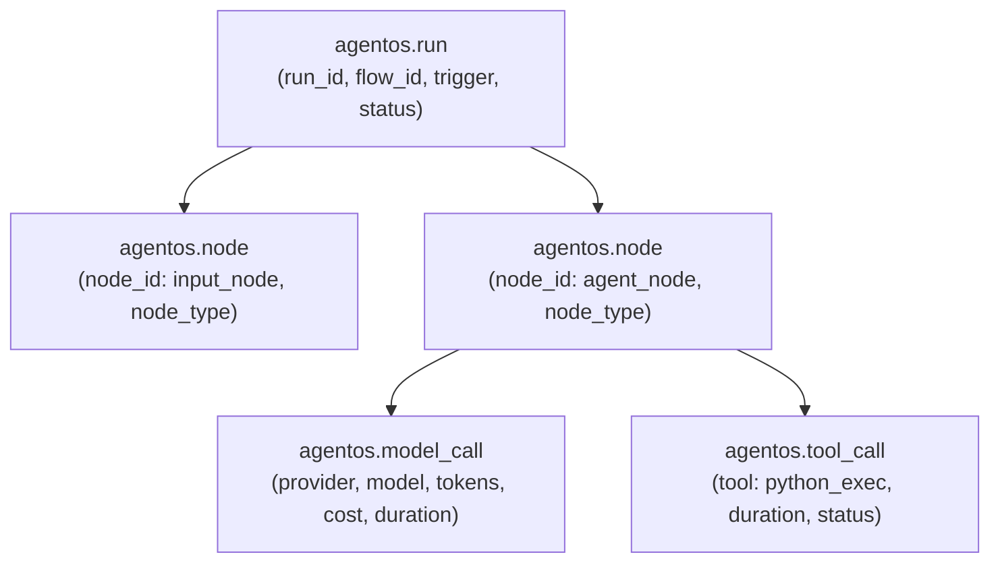

# Observability & OpenTelemetry in AgentOS

AgentOS 2.0 provides opt-in, production-grade observability via [OpenTelemetry](https://opentelemetry.io/) (OTEL) for distributed tracing and operational metrics.

## Privacy & Security Guarantee

> [!IMPORTANT]
> **Metadata Only Invariant**: AgentOS enforces an absolute privacy boundary for all telemetry export. Span names, attributes, events, and metrics **never** contain prompt text, model output, tool arguments or results, ticket/payload content, secrets, keys, or authentication tokens. All values are strict identifiers, status enums, numbers (tokens, cost, latency), or sanitized names.

---

## Quickstart: Local Tracing with Jaeger

You can run an all-in-one Jaeger instance with native OTLP ingestion in a single Docker command:

```bash
docker run -d --name jaeger \
  -e COLLECTOR_OTLP_ENABLED=true \
  -p 4317:4317 \
  -p 4318:4318 \
  -p 16686:16686 \
  jaegertracing/all-in-one:latest
```

### 1. Install OTEL Extra

```bash
pip install "agentos[otel]"
```

Or install the pinned packages:
```bash
pip install opentelemetry-sdk==1.45.2 opentelemetry-exporter-otlp-proto-grpc==1.45.2 opentelemetry-exporter-otlp-proto-http==1.45.2
```

### 2. Configure AgentOS

Set the standard OpenTelemetry environment variables before launching AgentOS:

```powershell
$env:OTEL_EXPORTER_OTLP_ENDPOINT = "http://localhost:4317"
$env:OTEL_SERVICE_NAME = "agentos"
```

Or on Linux / macOS:
```bash
export OTEL_EXPORTER_OTLP_ENDPOINT="http://localhost:4317"
export OTEL_SERVICE_NAME="agentos"
```

### 3. View Traces

Open your browser to:
[http://localhost:16686](http://localhost:16686)

Select service `agentos` to inspect flow run traces, node execution spans, LLM calls, and tool invocations.

In the AgentOS UI, every flow run stores its 32-character hexadecimal OpenTelemetry Trace ID in the Results Panel with a **Copy** button. You can search directly in Jaeger using this Trace ID.

---

## Production Setup: Sending Telemetry to Grafana

In production environments, telemetry is typically routed to an [OpenTelemetry Collector](https://opentelemetry.io/docs/collector/) or directly to Grafana Tempo (traces) and Grafana Mimir / Prometheus (metrics).

### Environment Variables

| Variable | Description | Default | Example |
|---|---|---|---|
| `OTEL_EXPORTER_OTLP_ENDPOINT` | Target OTLP gRPC or HTTP endpoint. Setting this enables OTEL export. | *(disabled)* | `http://otel-collector:4317` or `https://tempo.example.com` |
| `OTEL_SERVICE_NAME` | Service name attached to all spans and metrics | `agentos` | `agentos-prod-us-east` |
| `OTEL_RESOURCE_ATTRIBUTES` | Additional standard OTEL resource attributes | *(none)* | `deployment.environment=production,service.version=2.0` |

### Grafana Agent / OTEL Collector Example

When running the standard OpenTelemetry Collector, configure the receiver:

```yaml
receivers:
  otlp:
    protocols:
      grpc:
        endpoint: 0.0.0.0:4317
      http:
        endpoint: 0.0.0.0:4318

exporters:
  otlp/tempo:
    endpoint: tempo:4317
    tls:
      insecure: true
  prometheus:
    endpoint: 0.0.0.0:8889

service:
  pipelines:
    traces:
      receivers: [otlp]
      exporters: [otlp/tempo]
    metrics:
      receivers: [otlp]
      exporters: [prometheus]
```

---

## Trace Hierarchy

AgentOS structures traces into a logical hierarchy corresponding to execution flow:



### Span Details

- **`agentos.run`**: Root span representing the entire flow run.
  - Attributes: `agentos.run_id`, `agentos.flow_id`, `agentos.trigger`, `agentos.run.status`.
- **`agentos.node`**: Child span for each node in the DAG.
  - Attributes: `agentos.node_id`, `agentos.node_type`.
- **`agentos.model_call`**: Child span for LLM provider completions.
  - Attributes: `agentos.model.provider`, `agentos.model.model`, `agentos.node_id`, `agentos.model.prompt_tokens`, `agentos.model.completion_tokens`, `agentos.model.cost_usd`, `agentos.model.fallback_attempts`.
- **`agentos.tool_call`**: Child span for mediated tool and sandbox executions.
  - Attributes: `agentos.tool.name`, `agentos.node_id`, `agentos.tool.status`, `agentos.tool.limit_hit`.

---

## Operational Metrics

When OpenTelemetry is enabled, AgentOS emits the following metric instruments:

| Metric Name | Type | Description | Attributes |
|---|---|---|---|
| `agentos.runs.total` | Counter | Total workflow runs | `status` (`succeeded`, `failed`, `cancelled`, `waiting`) |
| `agentos.model_calls.total` | Counter | Total LLM invocations | `provider`, `model`, `success` (`true`, `false`) |
| `agentos.tokens.total` | Counter | Total token usage | `provider`, `model`, `type` (`prompt`, `completion`) |
| `agentos.cost.total` | Counter | Cumulative estimated model cost in USD | `provider`, `model` |
| `agentos.model_fallbacks.total` | Counter | Provider fallback attempts | `provider`, `model` |
| `agentos.model_call.duration` | Histogram | Model call latency in milliseconds | `provider`, `model` |
| `agentos.tool_calls.total` | Counter | Mediated tool and sandbox invocations | `tool`, `status`, `limit_hit` |
| `agentos.blocked_calls.total` | Counter | Invocations blocked by security/sink policy | *(none)* |
| `agentos.refused_publishes.total`| Counter | Flow publish requests refused by static analysis | *(none)* |

---

## Non-Blocking & Drop Resilience

OpenTelemetry uses the standard `BatchSpanProcessor` configured with a bounded in-memory buffer (`max_queue_size=512`, `max_export_batch_size=64`).

If the telemetry collector is unreachable, offline, or slow:
- Telemetry exports fail silently in the background worker thread.
- Dropped spans and metrics are tracked internally.
- Flow execution and user requests **never** block, slow down, or fail due to telemetry delivery issues.
